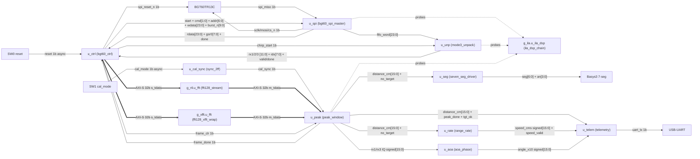

# Architecture Report — radar_bgt_c

Source of truth: `rtl/` and `vivado/` (simulation output ignored). Top: `rtl/radar_top.v`. Target: Basys3 Artix-7 (`xc7a35tcpg236-1`).

## 1. System Overview

`radar_bgt_c` is a processor-free Artix-7 SPI host for the Infineon BGT60TR13C. The FPGA configures a single-chirp FMCW scene (128 samples × 3 RX, Mode-3 FIFO), drains 192 × 24-bit FIFO words at 12.5 MHz SPI, unpacks them into time-aligned ADC triplets, then runs three sequential 128-point range FFTs on the same core. After non-coherent integration, optional empty-room subtract, and a nearest-bin search in range bins 15…37 (~40 cm–1 m), the design publishes inter-frame range-rate speed, RX1/RX3 azimuth, 7-segment centimetres, and a 115200 8N1 ASCII UART line at ≤200 Hz.

The entire FPGA fabric uses one 100 MHz clock. There is no MicroBlaze, DMA, AXI interconnect, range-Doppler cube, or Doppler FFT. Production bitstream generics in `vivado/create_project.tcl` are `USE_XFFT=1 USE_ILA=1` (Xilinx FFT 9.1 pipelined streaming + optional ILA). The RTL default is `USE_XFFT=0`, which binds the behavioral `fft128_stream` core used by simulation.

Control lives in `u_ctrl (bgt60_ctrl)`: hardware DIO3 reset, MAIN soft-reset poll, CHIP_ID check, 24-entry register ROM, FSTAT.CREF poll, 192-word burst, sequential FFT feed with DC subtract, then MAIN FSM_RESET / FRAME_START for the next 1-chirp frame (~670 Hz radar frames, UART decimated separately). UART `flags` are assembled in `radar_top` from latched `tgt_ok` (bit0) and `speed_ok` (bit3) plus the sticky error/overflow LEDs. Azimuth `θ_x10` is a 32-bit widened linear map of wrapped Δφ, not an arcsin LUT.

## 2. Architecture Delta (What Changed?)

Compared to the previous `reports/ARCHITECTURE_REPORT.md` (initial baseline):

* **`u_aoa (aoa_phase)` θ_x10 multiply is 32-bit.** `S_OUT` no longer does a 16-bit `dphi * 300 / 1440` (1440×300 = 432000 wraps to −18). It sign-extends `dphi` to 32 bits, multiplies by `32'sd300`, and divides by `32'sd1440`. CORDIC working vectors `cx`/`cy` are also 32-bit sign-extended copies of the 16-bit IQ inputs (16 CORDIC iterations unchanged). There is still no arcsin LUT — the map remains linear.
* **UART flags use `tgt_ok` / `speed_ok`, not a forced bit3.** `radar_top` no longer overwrites `lat_flags` with `{4'd0, 1'b1, overflow_err, error_flag, ~no_target}` at send time. On `peak_done` it latches `tgt_ok <= ~no_target` and clears `speed_ok`. `speed_ok` is set only if `u_rate` pulses `speed_valid` during the 50-cycle settle window. The send word is `{4'd0, speed_ok, overflow_err, error_flag, tgt_ok}`.
* **`u_rate (range_rate)` now drops history on every `no_target`.** A lone `no_target` pulse clears `have` and zeros `speed_cms` immediately. The previous “clear only if `no_target` and gap > 10 ms” path is gone. `MAX_GAP_US=10000` still rejects a pair of valid hits whose Δt is too large.

## 3. System Block Diagram

### 3.1 Main data-flow pipeline

```mermaid
%%{init: {"flowchart": {"curve": "linear", "rankSpacing": 90, "nodeSpacing": 48}}}%%
graph LR
    BGT["BGT60TR13C"]
    u_spi["u_spi (bgt60_spi_master)"]
    u_unp["u_unp (mode3_unpack)"]
    u_rom["u_rom (bgt60_reg_rom)"]
    u_ctrl["u_ctrl (bgt60_ctrl)"]
    u_fft["u_fft (fft128_stream | fft128_xfft_wrap)"]
    u_peak["u_peak (peak_window)"]
    u_bg["u_bg (bg_profile_sub)"]
    u_rate["u_rate (range_rate)"]
    u_aoa["u_aoa (aoa_phase)"]
    u_seg["u_seg (seven_seg_driver)"]
    u_telem["u_telem (telemetry)"]
    u_tx["u_tx (uart_tx)"]
    SEG["Basys3 7-seg"]
    UART["USB-UART TX"]

    BGT --->|"MISO 1b"| u_spi
    u_spi --->|"MOSI / SCLK / CS_N 1b"| BGT
    u_rom --->|"addr[6:0] + data[23:0]"| u_ctrl
    u_ctrl --->|"cmd[1:0] addr[6:0] wdata[23:0]"| u_spi
    u_spi --->|"fifo_word[23:0]"| u_unp
    u_unp --->|"rx1/rx2/rx3 [11:0] + idx[7:0]"| u_ctrl
    u_ctrl ===>|"AXI-S 32b {0, re[15:0]}"| u_fft
    u_fft ===>|"AXI-S 32b {im[15:0], re[15:0]}"| u_peak
    u_peak --->|"NCI mag[31:0] + idx[7:0]"| u_bg
    u_bg --->|"mag_out[31:0] + idx[7:0]"| u_peak
    u_peak --->|"distance_cm[15:0]"| u_rate
    u_peak --->|"rx1/rx3 IQ signed[15:0] x4"| u_aoa
    u_peak --->|"distance_cm[15:0]"| u_seg
    u_peak --->|"distance_cm[15:0] + tgt_ok 1b"| u_telem
    u_rate --->|"speed_cms signed[15:0] + speed_ok 1b"| u_telem
    u_aoa --->|"angle_x10 signed[15:0]"| u_telem
    u_telem --->|"data[7:0]"| u_tx
    u_seg --->|"seg[6:0] + an[3:0]"| SEG
    u_tx --->|"uart_tx 1b"| UART
```

`u_fft` is one of two generate alternatives: `g_rtl.u_fft (fft128_stream)` when `USE_XFFT=0`, or `g_xfft.u_fft (fft128_xfft_wrap)` wrapping `u_xfft (xfft_0)` when `USE_XFFT=1`. Thick arrows are AXI-Stream (`tdata`/`tvalid`/`tready`/`tlast`). `u_rom`, `u_bg`, and `u_tx` are nested instances. `tgt_ok` / `speed_ok` are `radar_top` registers, not ports of `u_telem`.

### 3.2 Top-level module `radar_top`

Every instance declared in `rtl/radar_top.v`, plus board/sensor endpoints.

`g_rtl.u_fft` and `g_xfft.u_fft` are mutually exclusive (`generate if (USE_XFFT)`). `g_ila.u_ila_dsp` exists only when `USE_ILA=1`. Inline `rst_pipe` in `radar_top` is a 2-FF reset synchronizer, not a named instance. `tgt_ok` / `speed_ok` live in the top-level telemetry latch, not as extra module ports.

## 4. Pipeline Stages Explained

### 4.1 `u_cal_sync (sync_2ff)`

* **Instance / Module Name:** `u_cal_sync (sync_2ff)`
* **Input/Output:** `d` = async `cal_mode` (SW1, 1-bit). `q` = `cal_sync` (1-bit, FPGA `clk` domain).
* **Clock Domain:** `clk` 100 MHz. Reset by `rst_sync`.
* **Operation:** Two-flip-flop synchronizer (`ASYNC_REG`) that brings the empty-room calibration switch into the system clock before it reaches `u_peak`.

### 4.2 `u_spi (bgt60_spi_master)`

* **Instance / Module Name:** `u_spi (bgt60_spi_master)`
* **Input/Output:** Command: `start`, `cmd[1:0]` (0=write, 1=read, 2=FIFO burst), `addr[6:0]`, `wdata[23:0]`, `burst_nwords[9:0]`. Status: `busy`, 1-cycle `done`, `rdata[23:0]`, `gsr0[7:0]`. Burst data: `fifo_word[23:0]`, 1-cycle `fifo_word_valid`. Pins: `spi_sclk`, `spi_mosi`, `spi_cs_n` (idle 1), `spi_miso`.
* **Clock Domain:** `clk` 100 MHz. `spi_sclk` is a generated I/O (sysclk/8 = 12.5 MHz), not a fabric clock.
* **Operation:** SPI mode-0 master. Register frames are 32 bits MSB-first `{addr[6:0], R/W, data[23:0]}`. Burst header is `32'hFFC0_0000`, then 192 × 24-bit FIFO words. Half-period divider `HALF=3` (4 `clk` cycles per half SCLK).

### 4.3 `u_unp (mode3_unpack)`

* **Instance / Module Name:** `u_unp (mode3_unpack)`
* **Input/Output:** `chirp_start` (pulse), `word[23:0]`, `word_valid`. Outputs unsigned 12-bit `rx1`, `rx2`, `rx3`, `sample_idx[7:0]` (0…127), 1-cycle `sample_valid` per time-aligned triplet, 1-cycle `chirp_done` after sample 127.
* **Clock Domain:** `clk` 100 MHz.
* **Operation:** Datasheet §5.2 Mode-3 unpack. Three-word groups: `{ADC1[2k], ADC2[2k]}`, `{ADC3[2k], ADC1[2k+1]}`, `{ADC2[2k+1], ADC3[2k+1]}` for k = 0…63. 192 words become 128 samples × 3 RX. Hold registers keep RX2 (even) and RX1 (odd) across word boundaries.

### 4.4 `u_rom (bgt60_reg_rom)` — nested in `u_ctrl`

* **Instance / Module Name:** `u_rom (bgt60_reg_rom)`
* **Input/Output:** Combinational lookup: `idx[4:0]` → `addr[6:0]`, `data[23:0]`, `last` (idx == 23).
* **Clock Domain:** Combinational; sampled by `u_ctrl` on `clk`.
* **Operation:** 24-entry ROM for the 1-chirp / 128-sample / 3-RX scene (MAIN, ADC0 2 Msps, PACR, SFCTL CREF=191, chirp/PLL including PLL1_7 T_SED ≈ 1.395 ms). `u_ctrl` walks the table during `S_CFG` / `S_CFGD`.

### 4.5 `u_ctrl (bgt60_ctrl)`

* **Instance / Module Name:** `u_ctrl (bgt60_ctrl)`
* **Input/Output:** SPI command bus as above; `spi_rdata[23:0]`, `spi_gsr0[7:0]` (unused), `spi_fifo_*` (unused; unpacker consumes the FIFO stream). Radar `spi_reset_n`. Sample path: `rx1/rx2/rx3 [11:0]`, `sample_idx[7:0]`, `sample_valid`, `chirp_start`/`chirp_done`. FFT AXIS slave: `fft_s_tdata[31:0]`, `fft_s_tvalid`, `fft_s_tlast`, `fft_s_tready`. Handshake: `dsp_done` (`peak_done`), `frame_clr`. Sticky `error_flag`, `overflow_err`.
* **Clock Domain:** `clk` 100 MHz.
* **Operation:** Frame FSM. Wait/reset → 1 ms high / 1 ms low / 1 ms high on `spi_reset_n` → MAIN SW_RESET poll until bits [3:1] clear → read CHIP_ID 0x02 (require DIGITAL_ID=3, RF_ID=3) → ROM config → MAIN FRAME_START → poll FSTAT (0x5F): bit 23 sets `overflow_err`, bit 21 (CREF) starts a 192-word burst. Stores 128 × 12-bit samples per RX, then feeds three sequential 128-point FFTs with `feed_s = {4'b0, sample} - 2048` packed as `{16'd0, feed_s}`. After `dsp_done`, writes MAIN FSM_RESET and repeats. `sw_reset` (raw SW0) forces `S_WAIT`. `FAST_SIM` shortens timers.

### 4.6 `g_rtl.u_fft (fft128_stream)` — `USE_XFFT=0`

* **Instance / Module Name:** `g_rtl.u_fft (fft128_stream)`
* **Input/Output:** AXI-Stream 32-bit `{imag[15:0], real[15:0]}` signed Q15-like. Slave `s_tdata/s_tvalid/s_tlast/s_tready`, master `m_tdata/m_tvalid/m_tlast/m_tready`. `radar_top` ties `m_tready = 1`.
* **Clock Domain:** `clk` 100 MHz.
* **Operation:** Behavioral 128-point scaled radix-2 DIT FFT. Bit-reversed load into `mem_re`/`mem_im`, seven in-place stages with Q15 twiddles from `twiddle_q15_128.vh`, 1-bit scale per butterfly (`sum/dif >> 1`), natural-order unload. Used by simulation and when the XFFT IP is not bound.

### 4.7 `g_xfft.u_fft (fft128_xfft_wrap)` — `USE_XFFT=1`

* **Instance / Module Name:** `g_xfft.u_fft (fft128_xfft_wrap)`
* **Input/Output:** Same AXI-Stream 32-bit IQ ports as `fft128_stream`.
* **Clock Domain:** `clk` 100 MHz.
* **Operation:** Production wrapper around Xilinx FFT 9.1 (`xfft_0`). Holds `aresetn` low for three clocks after `rst`, then writes config `16'h00AB` (forward + scale schedule) on `s_axis_config` once. Gates `s_tvalid` until config completes. IP settings from `vivado/create_ips.tcl`: length 128, pipelined streaming, 16-bit data/phase, scaled, truncation, natural order, 100 MHz, 1 channel.

### 4.8 `u_xfft (xfft_0)` — nested in `fft128_xfft_wrap`

* **Instance / Module Name:** `u_xfft (xfft_0)`
* **Input/Output:** AXI-Stream data 32-bit + AXI-Stream config 16-bit. Events left unconnected.
* **Clock Domain:** `clk` 100 MHz (`aclk`).
* **Operation:** Xilinx FFT 9.1 core generated by `vivado/create_ips.tcl`. Transforms each 128-sample RX chirp; `u_ctrl` runs it three times per frame (RX1, RX2, RX3).

### 4.9 `u_peak (peak_window)`

* **Instance / Module Name:** `u_peak (peak_window)`
* **Input/Output:** Signed `bin_re[15:0]`, `bin_im[15:0]` from FFT `m_tdata`, `bin_valid`, `fft_last`. `frame_clr`, `cal_mode`. Outputs 1-cycle `frame_done`, unsigned `distance_cm[15:0]`, `no_target`, `peak_bin[7:0]`, and signed 16-bit `rx1_re/rx1_im/rx3_re/rx3_im` at the winning bin. Defaults: `BIN_LO=15`, `BIN_HI=37`, `FLOOR=4096`.
* **Clock Domain:** `clk` 100 MHz.
* **Operation:** Collects three RX FFTs. Bins 0…63 accumulate NCI `re²+im²` (saturating 32-bit). RX1 and RX3 IQ are stored for AoA. Dumps the 64-bin profile through `u_bg`, then searches nearest local-max bin ≥ floor in 15…37. `distance_cm = (k * 2727 + 500) / 1000`. During `cal_mode` / `cal_active` the search reports `no_target`. `frame_clr` from `u_ctrl` resets collection at FRAME_START.

### 4.10 `u_bg (bg_profile_sub)` — nested in `u_peak`

* **Instance / Module Name:** `u_bg (bg_profile_sub)`
* **Input/Output:** `mag_in[31:0]`, `idx_in[7:0]`, `valid_in`, `last_in`, `cal_mode`. Outputs `mag_out[31:0]`, `idx_out[7:0]`, `valid_out`, `last_out`, `cal_active`. `CAL_FRAMES=8`.
* **Clock Domain:** `clk` 100 MHz.
* **Operation:** Rising `cal_mode` starts an 8-frame accumulate into 40-bit `acc[64]`. Last cal frame stores `acc >> 3` into BRAM `baseline[64]`. In run mode, output is `max(mag_in - baseline, 0)`. While `cal_mode` remains high after the run, `mag_out` is forced to 0.

### 4.11 `u_rate (range_rate)`

* **Instance / Module Name:** `u_rate (range_rate)`
* **Input/Output:** `sample_valid` (`peak_done`), `no_target`, unsigned `distance_cm[15:0]`. Outputs signed `speed_cms[15:0]` (cm/s, saturate ±32767) and 1-cycle `speed_valid`. `MAX_GAP_US=10000`.
* **Clock Domain:** `clk` 100 MHz.
* **Operation:** Microsecond counter (`div100` 0…99). On `no_target`, clears `have` and zeros `speed_cms` (no `speed_valid` pulse). On a valid target with a previous hit and 0 < Δt ≤ 10 ms: `speed_cms = (R_n - R_{n-1}) * 1e6 / dt_us` via restoring 32-bit divider; approaching (range decrease) is negative. First hit, or a valid pair whose Δt > 10 ms, stores history without publishing speed.

### 4.12 `u_aoa (aoa_phase)`

* **Instance / Module Name:** `u_aoa (aoa_phase)`
* **Input/Output:** `start` (`peak_done`), `valid_iq` (`!no_target`), signed 16-bit `re1/im1/re3/im3`. Outputs 1-cycle `done` and signed `angle_x10[15:0]` (degrees × 10).
* **Clock Domain:** `clk` 100 MHz.
* **Operation:** Two 16-iteration CORDIC atan2 passes (RX1 then RX3) on 32-bit sign-extended `cx`/`cy`. Phase unit is 1/16 degree (180° = 2880). Wrapped Δφ is converted by the 32-bit linear map `θ_x10 = sign_extend(dphi) * 300 / 1440` (negative Δφ uses the absolute value then negates). Comment claims `θ = arcsin(Δφ/π)` with d = λ/2; the hardware is the linear scale, not a LUT. If `valid_iq=0`, angle is 0 and `done` is immediate.

### 4.13 `u_seg (seven_seg_driver)`

* **Instance / Module Name:** `u_seg (seven_seg_driver)`
* **Input/Output:** Unsigned `value[15:0]` (`distance_cm`), `blank` (`no_target`). Outputs active-low `seg[6:0]` (A…G) and `an[3:0]`.
* **Clock Domain:** `clk` 100 MHz.
* **Operation:** Double-dabble binary-to-BCD, 4-digit multiplex. `blank` lights only segment G on every digit (`----`).

### 4.14 `u_telem (telemetry)`

* **Instance / Module Name:** `u_telem (telemetry)`
* **Input/Output:** `send` pulse, `seq[15:0]`, `dist_cm[15:0]`, signed `speed_cms[15:0]`, signed `angle_x10[15:0]`, `flags[7:0]`. Outputs `uart_tx`, `busy`. `CLKS_PER_BIT=868` (115200 at 100 MHz; 8 in `FAST_SIM`).
* **Clock Domain:** `clk` 100 MHz.
* **Operation:** Formats `S,<seq>,<dist_cm>,<speed_cms>,<angle_x10>,<flags>\n` with sign and leading-zero suppression. `radar_top` latches DSP results, waits 50 cycles for speed/AoA, then rate-limits with `TELEM_WAIT` (500_000 clocks = 5 ms → 200 Hz). Flags at send are `{4'd0, speed_ok, overflow_err, error_flag, tgt_ok}` — bit0 is the latched target, bit3 is a real `speed_valid` seen in the settle window.

### 4.15 `u_tx (uart_tx)` — nested in `u_telem`

* **Instance / Module Name:** `u_tx (uart_tx)`
* **Input/Output:** `data[7:0]`, `start`. Outputs `busy`, `tx` (idle 1).
* **Clock Domain:** `clk` 100 MHz.
* **Operation:** 8N1 shifter: start bit, LSB-first data, stop bit. Bit period = `CLKS_PER_BIT` system clocks.

### 4.16 `g_ila.u_ila_dsp (ila_dsp_chain)` — `USE_ILA=1`

* **Instance / Module Name:** `g_ila.u_ila_dsp (ila_dsp_chain)`
* **Input/Output:** 18 probes, widths `{1,1,1,24,1,12,12,12,8,1,1,1,16,1,16,16,1,1}`: MISO/SCLK/CS_N, FIFO word/valid, RX1/2/3, sample_idx/valid, chirp_done, peak_done, distance_cm, no_target, speed_cms, angle_x10, uart_tx, uart_start. Depth 2048. Clock `clk`.
* **Clock Domain:** `clk` 100 MHz.
* **Operation:** Optional ILA 6.2 (bitstream only). Does not probe MOSI, SPI command/address/wdata, or the register ROM.

## 5. Memory and Buffering

| Location | Storage | Why it is there |
| --- | --- | --- |
| `u_ctrl` `mem1/mem2/mem3` | 3 × 128 × 12-bit arrays | Capture the full Mode-3 chirp while the SPI burst is in progress, then replay each RX into the single FFT core. |
| `fft128_stream` `mem_re`/`mem_im` | 2 × 128 × 16-bit signed | In-place radix-2 working set (bit-reversed load, natural unload). |
| `xfft_0` (IP) | Internal pipeline RAM | Streaming 128-pt FFT when `USE_XFFT=1`. |
| `u_peak` `nci[64]`, `work[64]` | 64 × 32-bit | NCI magnitude profile and post-subtract working copy for the nearest-bin search. |
| `u_peak` `iq1_*[64]`, `iq3_*[64]` | 4 × 64 × 16-bit signed | Hold RX1/RX3 complex bins so AoA can use the winning index after search. |
| `u_bg` `baseline[64]`, `acc[64]` | 64 × 32-bit and 64 × 40-bit BRAM (`ram_style = "block"`) | Empty-room average (8 frames, `acc >> 3`) and run-time subtract. |
| `u_unp` `hold_rx2`, `hold_odd_rx1` | 2 × 12-bit | Align Mode-3 24-bit words into even/odd sample triplets. |
| `u_spi` `tx_sr`/`rx_sr` | 2 × 32-bit shift registers | SPI bit bang and FIFO word assembly. |
| `u_aoa` `cx`/`cy` | 2 × 32-bit signed | Widened CORDIC vectors so 16-bit IQ does not overflow during shifts. |
| `u_rate` `cm_prev`, `t_prev` | 16-bit + 32-bit | Previous range and timestamp for ΔR/Δt. |
| `radar_top` `lat_*`, `tgt_ok`, `speed_ok` | 16-bit dist/speed/angle + 8-bit flags + 2 qualifier bits | Hold a coherent UART sample across the 50-cycle settle and 200 Hz gate; `speed_ok` records a real `speed_valid`. |
| `u_tx` `shift` | 8-bit | UART serializer. |
| `ila_dsp_chain` | 2048-sample capture RAM | Optional debug, not in the functional path. |

There is no async FIFO and no sample FIFO between SPI and FFT: the controller RAMs are the only chirp buffer.

## 6. Clock Domains and CDC (Clock Domain Crossing)

| Domain | Frequency | Role |
| --- | --- | --- |
| `clk` | 100 MHz (W5, 10 ns) | Entire FPGA design: SPI bit-bang, unpack, FFT, DSP, UART, 7-seg, ILA. |
| `spi_sclk` pin | 12.5 MHz (`clk`/8) | Generated SPI clock, **not** a clock network. |
| Radar `OSC_CLK` | 80 MHz XTAL on the shield | On-sensor only; never enters the FPGA. |

CDC / synchronization:

| Crossing | Method |
| --- | --- |
| SW0 `reset` → `rst_sync` | Inline 2-FF pipeline in `radar_top` (`rst_pipe`, `ASYNC_REG`). Active-high. |
| SW1 `cal_mode` → `cal_sync` | `u_cal_sync (sync_2ff)` 2-FF (`ASYNC_REG`). |
| `spi_miso` | Sampled inside `u_spi` on the generated SCLK rising edge (same `clk` FSM; not a second clock domain). |
| XFFT `aresetn` | 3-FF deassertion stretch in `fft128_xfft_wrap` after `rst` (same domain; IP reset timing, not CDC). |

No async FIFO, no Gray-code pointer CDC, no second FPGA MMCM/PLL clock. Single-domain design per DECISION-003.

## 7. Specification vs. Implementation Gaps

Compared to `docs/architecture.md`, `docs/hardware-contract.md`, `docs/INTERFACES.md`, and `docs/requirements.md`:

1. **REQ-008 / architecture §7 azimuth is linear, not `arcsin`.** Both documents specify `θ = arcsin(Δφ/π)` with `d = λ/2`. `aoa_phase` implements `θ_x10 = sign_extend32(dphi) * 300 / 1440` after a wrap to ±180° (phase unit 1/16°). That is a linear map (30° at Δφ = 90°, 60° at Δφ = 180°) rather than `arcsin(1) = 90°`. The 32-bit widen fixes wraparound of the product; it does not add the specified LUT/interpolation.

2. **REQ-007 residual: UART speed field is not cleared on invalidate.** `u_rate` now zeros `speed_cms` and drops `have` on `no_target`, and `speed_ok` (flags bit3) is honest. `radar_top` still keeps the last `lat_speed` until a new `speed_valid`, so a no-target or first-hit line can print the previous centimetres-per-second with bit3 = 0.

3. **REQ-002b error-LED clear timing.** The requirement says sticky LEDs clear *on the next SW0 release*. RTL clears `error_flag` / `overflow_err` in the `rst_sync` reset clause, so the LEDs go out while SW0 is still held high (two clocks after assert), not on the falling edge.

The previous report’s “flags bit3 forced to 1” gap is closed. 192-word Mode-3 packing, 128-pt scaled natural-order FFT, bins 15…37, centimetre formula, 12.5 MHz mode-0 SPI, FSTAT.CREF poll, 1-chirp / no Doppler cube, UART 115200 and ≤200 Hz gate, ILA probe map, and single 100 MHz domain still match the contracts.
